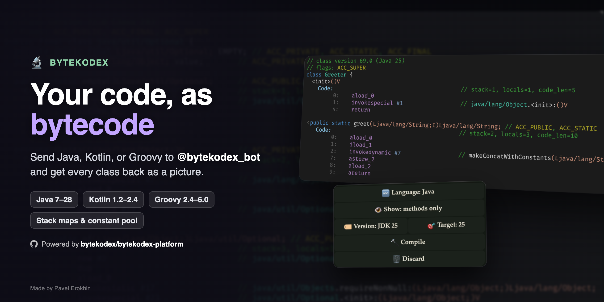
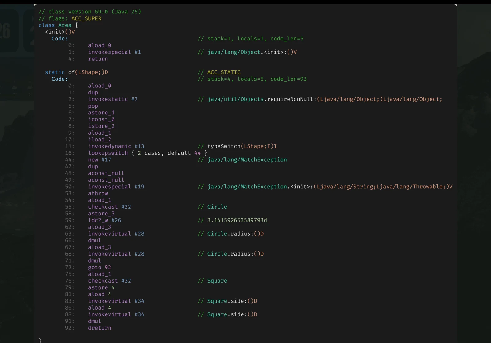
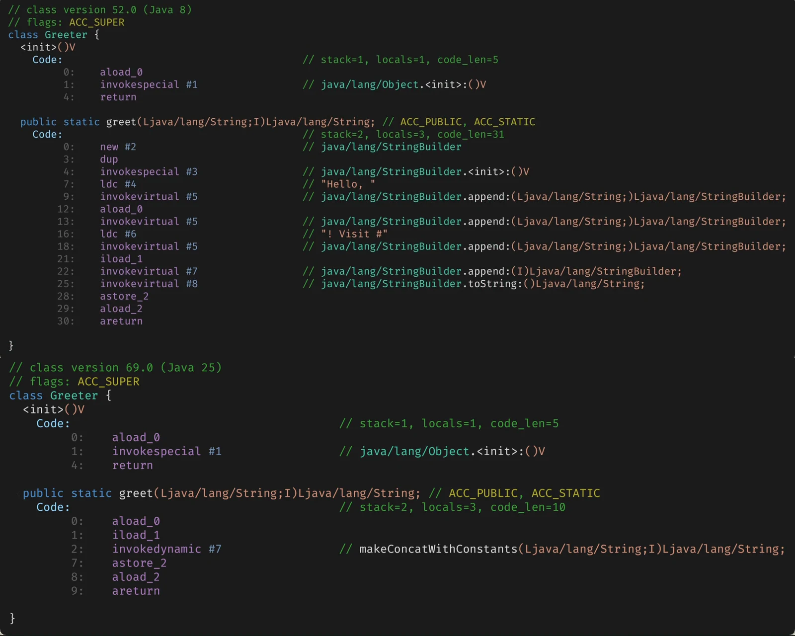
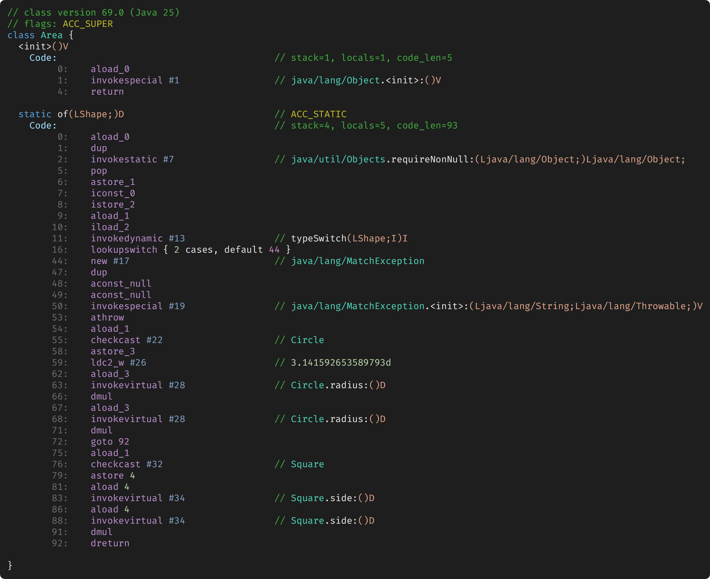
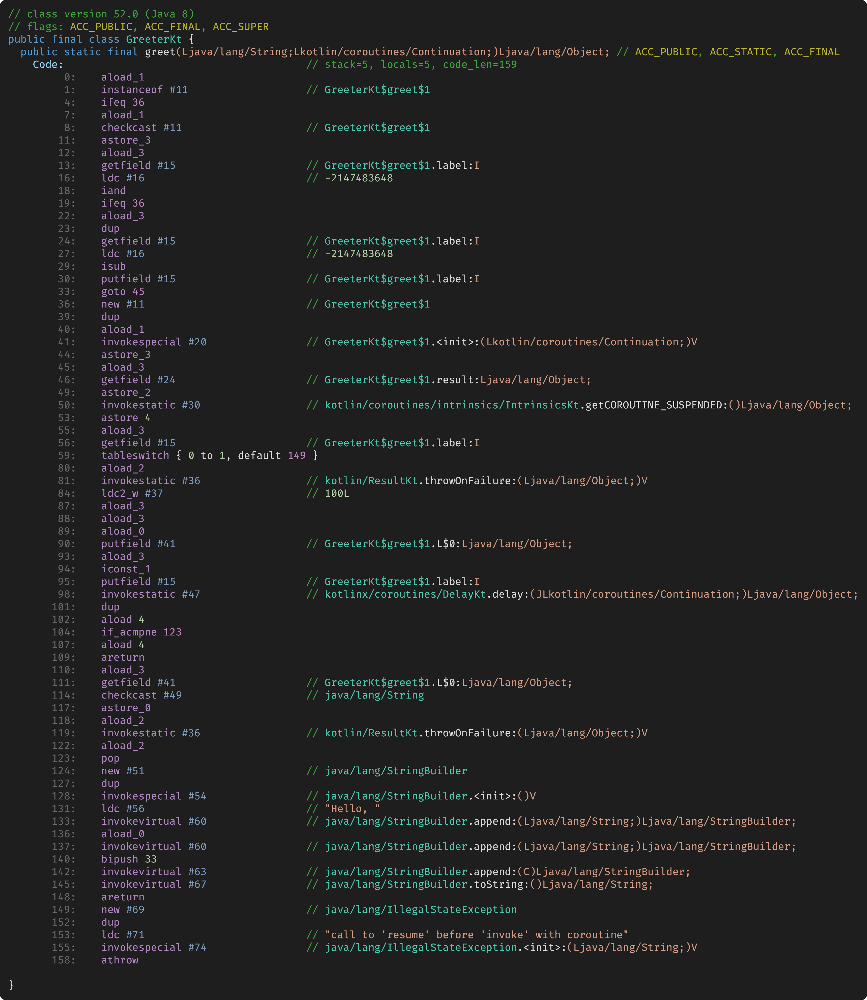

# 🔬 Bytekodex



<p align="center">
  <a href="https://t.me/bytekodex_bot"></a>
  <a href="https://github.com/bytekodex/bytekodex-telegram/releases/latest"></a>
  
  
  
  <a href="https://github.com/bytekodex/bytekodex-telegram/actions/workflows/ci.yml"></a>
  <a href="LICENSE"></a>
</p>

🔬 **Bytekodex** показывает, во что превращается ваш код. Пришлите Java, Kotlin или Groovy боту [@bytekodex_bot](https://t.me/bytekodex_bot) в Telegram, нажмите Compile и получите байткод картинкой: каждый метод с опкодами, пул констант, локальные переменные и stack map, в цвете и с удобной разметкой.

[English version](README.md)

## В чате

### Видео

#### Вставили, нажали Compile

<p align="center"><a href="https://github.com/bytekodex/bytekodex-telegram/blob/master/media/videos/java.mp4"></a>
  <br><sub>Вставьте кусок кода на Java: бот угадает язык, предложит разумные настройки и нарисует по картинке на каждый класс.</sub>
  <br><br><a href="https://github.com/bytekodex/bytekodex-telegram/blob/master/media/videos/java.mp4"></a></p>

#### Один метод, два компилятора

<p align="center"><a href="https://github.com/bytekodex/bytekodex-telegram/blob/master/media/videos/compare.mp4"></a>
  <br><sub>Одна и та же строка на JDK 8 и JDK 25: цепочка вызовов StringBuilder превращается в один invokedynamic к makeConcatWithConstants.</sub>
  <br><br><a href="https://github.com/bytekodex/bytekodex-telegram/blob/master/media/videos/compare.mp4"></a></p>

### Короткий ролик

<p align="center">
  <br><sub>Наберите имя класса JDK и посмотрите байткод, который поставляет сам JDK, без всякого компилятора</sub></p>

## Что вы получаете

- ☕ **Любая Java с 7 по 28.** Здесь каждый релиз, а не только LTS: именно в промежуточном релизе впервые появляется новая возможность. JDK 28 идёт с включёнными preview-возможностями.
- 🟣 **Kotlin с 1.2 по 2.4** и 🟢 **Groovy с 2.4 по 6.0**, по компилятору на каждый минорный релиз, kotlinx-coroutines уже в classpath.
- 🎯 **Любой таргет байткода.** Выберите компилятор и версию class-файла: Kotlin 2.4 под Java 8 или javac 25 с `--release 11`.
- 👁 **То, что нужно вам.** Методы всегда, а одним нажатием пул констант, локальные переменные, stack map, номера строк и атрибуты.
- 📚 **Классы самого JDK.** Пришлите только имя, например `java.util.HashMap`, и получите байткод из JDK нужной версии.
- 🧠 **Без лишних вопросов.** Бот сам угадывает язык, у каждой кнопки разумное значение по умолчанию, а одно сообщение с кнопками меняется по мере нажатий.
- 🖼️ **Чёткие картинки.** Страницы приходят файлами, а не фото, поэтому Telegram не размывает мелкие глифы в JPEG.
- 🔒 **Ваш код не выходит за пределы песочницы.** Каждая компиляция идёт в одноразовом контейнере без сети, с корнем только для чтения и ограничениями по памяти, процессам и времени.

## С чего начать

1. Откройте [@bytekodex_bot](https://t.me/bytekodex_bot) в Telegram.
2. Пришлите ему код на Java, Kotlin или Groovy либо имя класса JDK, например `java.lang.String`.
3. Нажмите **🔨 Compile**.

## Примеры

Sealed-интерфейс и `switch` по нему, скомпилированные javac 25. Сопоставление с образцом превращается в `invokedynamic` к `typeSwitch` и `lookupswitch`:

```java
sealed interface Shape permits Circle, Square {}
record Circle(double radius) implements Shape {}
record Square(double side) implements Shape {}

class Area {
    static double of(Shape shape) {
        return switch (shape) {
            case Circle c -> Math.PI * c.radius() * c.radius();
            case Square s -> s.side() * s.side();
        };
    }
}
```



Функция `suspend`, скомпилированная Kotlin. Один `delay` превращает её в конечный автомат: объект продолжения, поле `label` и `tableswitch`, который возобновляет работу с места остановки:

```kotlin
import kotlinx.coroutines.delay

suspend fun greet(name: String): String {
    delay(100)
    return "Hello, $name!"
}
```



## Разработчикам

Бот написан на Go поверх [Bytekodex Platform](https://github.com/bytekodex/bytekodex-platform) — библиотеки на Rust, которая читает class-файлы и рисует их. В [docs/development.md](docs/development.md) описано, как он устроен, как выходит релиз и как запустить свой экземпляр (на английском). Что приносит каждая версия, написано в [CHANGELOG.md](CHANGELOG.md).

## Связанные проекты

- **[Bytekodex Platform](https://github.com/bytekodex/bytekodex-platform)** — движок на Rust, который читает class-файлы и рисует их, с C ABI для вашего приложения.
- **[Рабочее пространство Bytekodex](https://github.com/bytekodex/.github)** — все репозитории Bytekodex одним клоном.
- **[Capsa](https://github.com/MairwunNx/Capsa)** — движок Kotlin Multiplatform для экранов из маленьких возможностей.
- **[Allay](https://github.com/allay-ai/minecraft)** — ИИ-помощник в чате Minecraft.
- **[WorldAPI](https://github.com/MairwunNx/minecraft-worldapi)** — сервер Minecraft по HTTP, для сайтов, ботов и ИИ-агентов.

> 🫡 Сделал Павел Ерохин (Pavel Erokhin), aka mairwunnx.
