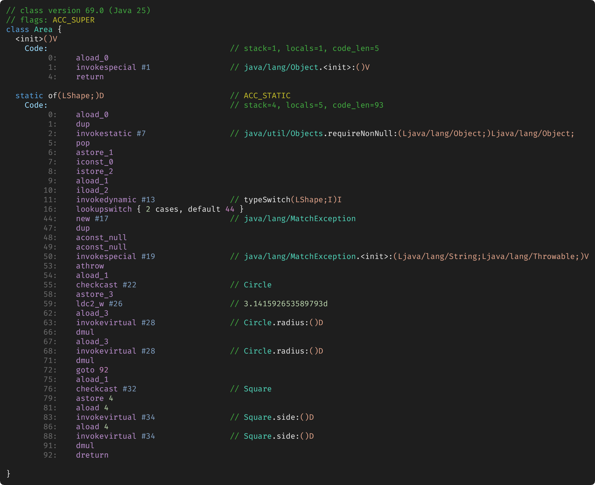
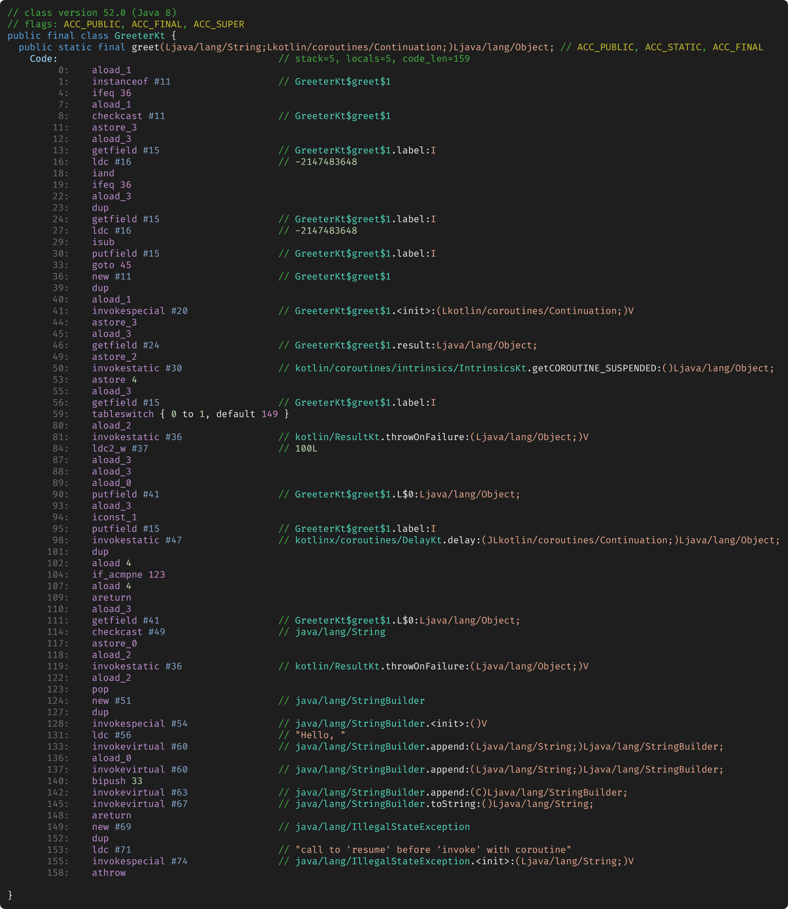

# bytekodex-telegram

The Telegram bot: send JVM source to [@bytekodex_bot](https://t.me/bytekodex_bot), get a picture of its bytecode.

## How it behaves

Send the bot a Java, Kotlin, or Groovy snippet. It guesses the language and answers with one message
of buttons that rewrites itself as you press them: the language, the compiler version, the bytecode
target, and what to show besides the methods—the constant pool, local variables, the stack map, line
numbers, and attributes. Every button starts at a sensible default, so nothing asks you a question
first. Press Compile, and you get one image per class.

Send just the name of a JDK class, like `java.lang.String`, and you get the bytecode the JDK ships.

tes, which the old bot could not do at all.

## Examples

A sealed interface and a `switch` over it, compiled by javac 25. The pattern match becomes an
`invokedynamic` to `typeSwitch` and a `lookupswitch`:

```java
sealed interface Shape permits Circle, Square {}
record Circle(double radius) implements Shape {}
record Square(double side) implements Shape {}

class Area {
    static double of(Shape shape) {
        return switch (shape) {
            case Circle c -> Math.PI * c.radius() * c.radius();
            case Square s -> s.side() * s.side();
        };
    }
}
```



A `suspend` function, compiled by Kotlin 2.3. One `delay` turns it into a state machine: a
continuation object, a `label` field, and a `tableswitch` that resumes where it stopped:

```kotlin
import kotlinx.coroutines.delay

suspend fun greet(name: String): String {
    delay(100)
    return "Hello, $name!"
}
```



## Layout

| Package | Role |
| --- | --- |
| `internal/detect` | Which language is this? A weighted guess, never a blocking question |
| `internal/toolchain` | The catalog: languages, compiler versions, bytecode targets, images |
| `internal/compile` | Runs a compiler in a locked-down container and reads the classes back |
| `internal/render` | cgo binding to the Rust platform over its C ABI |
| `internal/session` | Per-chat state, in memory, expiring |
| `internal/ui` | The keyboard and its callback encoding |
| `internal/bot` | Handlers |
| `cmd/bot` | Entry point |

## The image never touches disk

Rust writes the PNG into a Go byte slice that came from a pool, and the Telegram client streams
the upload straight out of that same slice. The bytes are written once and read once, there is no
temporary file to clean up, and the buffer goes back to the pool when the upload finishes.

The buffer belongs to Go, so nothing crosses the boundary owning memory. If a page does not fit,
the library reports the exact size it needs and one retry is always enough.

Pages go out as documents rather than photos. `sendPhoto` re-encodes on Telegram's servers, and
JPEG on small sharp glyphs is the worst case for the one thing this bot is for. A document keeps
the bytes exactly as rendered, and the width-plus-height cap of 10 000 does not apply to it.

## Compiling is running

Compiling source from a stranger executes their code. Groovy runs global AST transformations and
`@Grab` at compile time, `javac` runs any annotation processor it finds, and `kotlinc` loads
compiler plugins. So every compilation happens in a throwaway container with no network, a
read-only root, an empty capability set, a pid cap, a memory cap and a deadline. `javac` also gets
`-proc:none`.

## Deploying

A push to `master` that changes the bot runs `.github/workflows/bot.yml` on a GitHub-hosted runner.
It builds `ghcr.io/bytekodex/bot` from this repository and the platform, pushes it under the commit
and as `latest`, and asks the server to run that commit's image. The server keeps the bot in a sandbox: its own user
with a rootless Docker and a cap on memory and CPU, so neither the bot nor the compilers it starts
for strangers reach anything else on the machine.

Before the bot starts, the deploy runs `toolchainctl sync` from the same image. It pulls the image
of every compiler the lock offers, extracts each JDK's system classes, downloads the Kotlin
classpath jars, and makes the scratch directory, skipping whatever is already there.

A change to `toolchains/manifest.json` runs `.github/workflows/toolchains.yml`: it resolves the lock,
commits it, builds and pushes the toolchain images the registry doesn't have yet, and starts
`bot.yml`. The lock ships inside the bot's image, so the next deploy offers the new versions.

`bot.yml` needs one secret besides the automatic `GITHUB_TOKEN`: `FAMILY_ACTIONS_TOKEN`, which starts
the server's deploy.

### On your own machine

The bot starts its compilers through a Docker socket, and the daemon behind it resolves every
`--volume` path the bot hands it. So the data directory sits at the same path on the host and in
both containers:

```yaml
services:
  sync:
    image: ghcr.io/bytekodex/bot:latest
    user: "0:0"   # to chown the scratch directory to the bot's user
    entrypoint: [toolchainctl, sync, -dir, /opt/bytekodex, -root, /srv/bytekodex]
    volumes:
      - /var/run/docker.sock:/var/run/docker.sock
      - /srv/bytekodex:/srv/bytekodex

  bot:
    image: ghcr.io/bytekodex/bot:latest
    restart: unless-stopped
    depends_on: { sync: { condition: service_completed_successfully } }
    group_add: ["999"]   # the group that owns the socket: `stat -c %g /var/run/docker.sock`; "0" under rootless Docker
    environment:
      BYTEKODEX_TELEGRAM_TOKEN: ${TELEGRAM_BOT_TOKEN}
      BYTEKODEX_TOOLCHAIN_LOCK: /opt/bytekodex/lock.json
      BYTEKODEX_SYSCLASSES: /srv/bytekodex/sysclasses
      BYTEKODEX_DEPS: /srv/bytekodex/deps
      TMPDIR: /srv/bytekodex/scratch
    volumes:
      - /var/run/docker.sock:/var/run/docker.sock
      - /srv/bytekodex/scratch:/srv/bytekodex/scratch
      - /srv/bytekodex/deps:/srv/bytekodex/deps:ro
      - /srv/bytekodex/sysclasses:/srv/bytekodex/sysclasses:ro
```

The first `sync` pulls every compiler image and takes a while; later ones finish in seconds.

## Running it

The bot needs the platform's shared library, a monospace TrueType face, and a container runtime.

```shell
# Build the library from the platform repository first.
export CGO_LDFLAGS="-L/path/to/bytekodex-platform/target/release"
export LD_LIBRARY_PATH="/path/to/bytekodex-platform/target/release"

export BYTEKODEX_TELEGRAM_TOKEN=...
export BYTEKODEX_FONT=/path/to/JetBrainsMono-Regular.ttf
export BYTEKODEX_DEPS=/var/lib/bytekodex/deps   # jars for the Kotlin classpath

go run ./cmd/bot
```

| Variable | Default | Meaning |
| --- | --- | --- |
| `BYTEKODEX_TELEGRAM_TOKEN` | — | Required |
| `BYTEKODEX_FONT` | Fira Code from `fonts-firacode` | Single TrueType face; a `.ttc` is refused |
| `BYTEKODEX_FONT_SIZE` | `40` | Render cost is linear in pixels, and a client scales the image down anyway |
| `BYTEKODEX_DEPS` | — | Directory of jars mounted read-only for the classpath |
| `BYTEKODEX_TOOLCHAIN_LOCK` | `toolchains/lock.json` | Which compilers the keyboard offers |
| `BYTEKODEX_SYSCLASSES` | `/var/lib/bytekodex/sysclasses` | Each JDK's classes, from `toolchainctl sync`, for a message that is just a class name |
| `BYTEKODEX_CONTAINER_RUNTIME` | `docker` | `podman` works too |
| `BYTEKODEX_SESSION_TTL` | `30m` | How long a pasted snippet is remembered |

The header under `internal/render/include` is a vendored copy of the platform's. The two projects
release independently, so `New` checks `bk_abi_version` at startup and refuses to run against a
library it does not understand.

## Tests

```shell
go test ./...
```

The renderer tests skip themselves when no monospace face is installed. The compiler tests cover
the parts that do not need a container runtime, which notably includes the check that a filename
from a stranger cannot escape the scratch directory.

