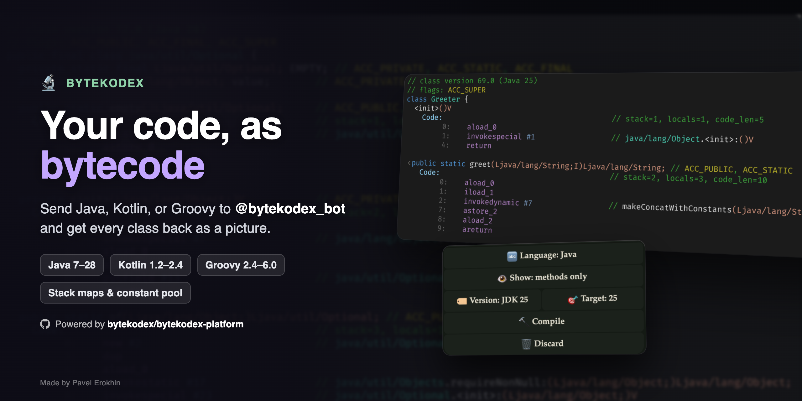
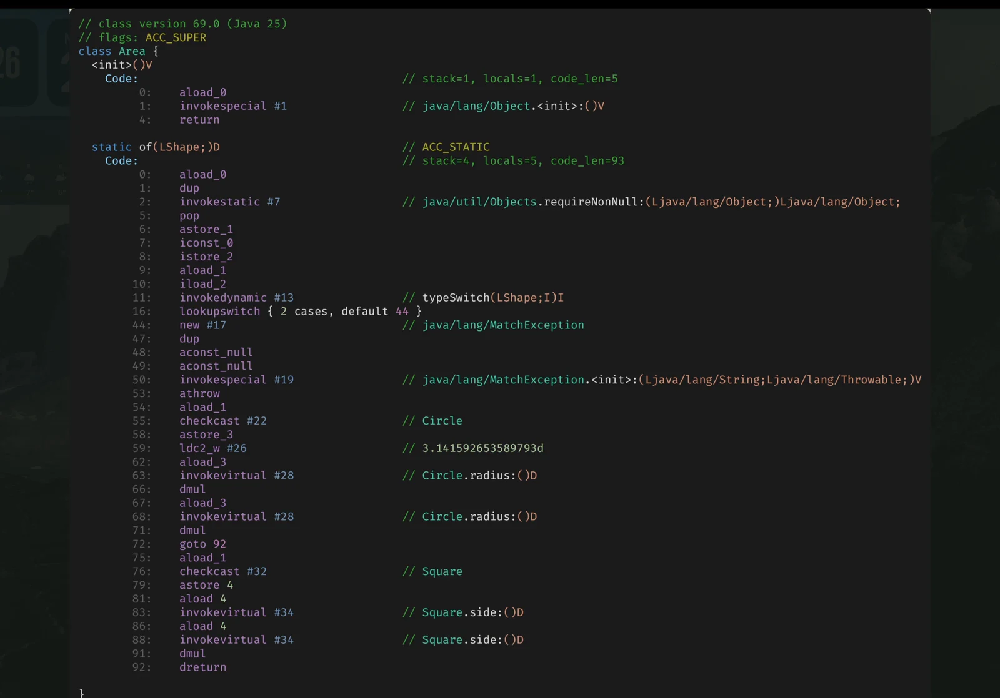
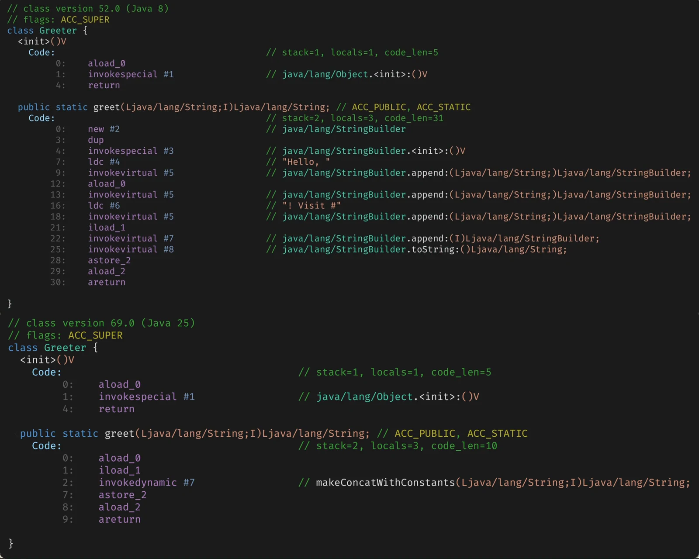
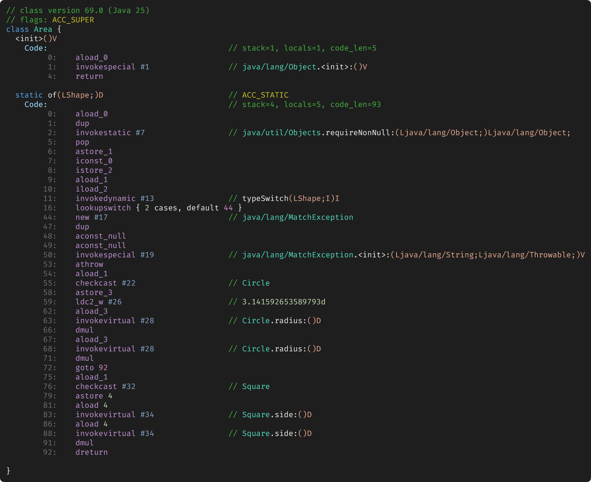
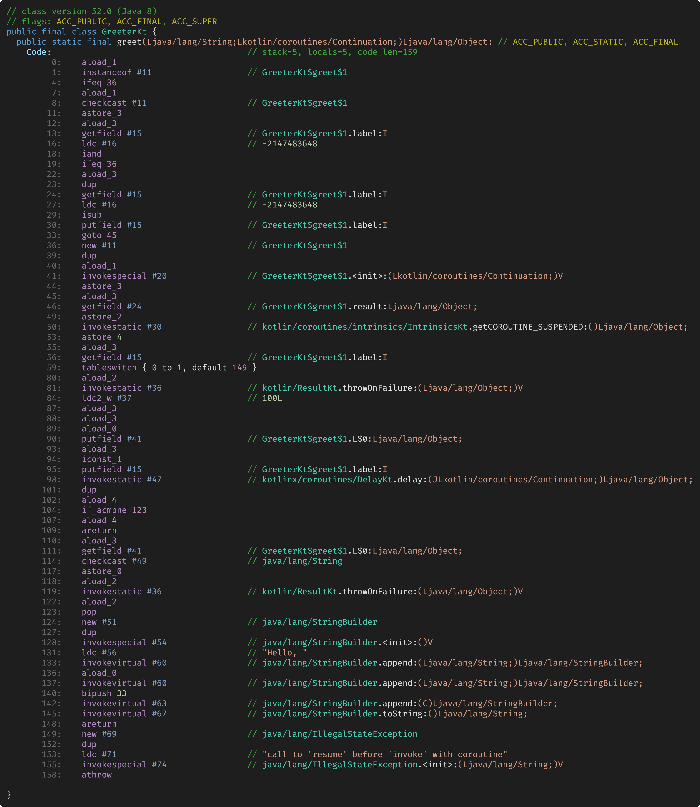

# 🔬 Bytekodex



<p align="center">
  <a href="https://t.me/bytekodex_bot"></a>
  <a href="https://github.com/bytekodex/bytekodex-telegram/releases/latest"></a>
  
  
  
  <a href="https://github.com/bytekodex/bytekodex-telegram/actions/workflows/ci.yml"></a>
  <a href="LICENSE"></a>
</p>

🔬 **Bytekodex** shows you what your code turns into. Send Java, Kotlin, or Groovy to [@bytekodex_bot](https://t.me/bytekodex_bot) in Telegram, press Compile, and get the bytecode back as a picture: every method with its opcodes, the constant pool, locals, and the stack map, colored and laid out to read.

[Русская версия](README.RU.md)

## In the chat

### Videos

#### Paste, press Compile

<p align="center"><a href="https://github.com/bytekodex/bytekodex-telegram/blob/master/media/videos/java.mp4"></a>
  <br><sub>Paste a Java snippet: the bot guesses the language, offers sensible defaults, and draws one picture per class.</sub>
  <br><br><a href="https://github.com/bytekodex/bytekodex-telegram/blob/master/media/videos/java.mp4"></a></p>

#### One method, two compilers

<p align="center"><a href="https://github.com/bytekodex/bytekodex-telegram/blob/master/media/videos/compare.mp4"></a>
  <br><sub>The same line on JDK 8 and JDK 25: a chain of StringBuilder calls becomes one invokedynamic to makeConcatWithConstants.</sub>
  <br><br><a href="https://github.com/bytekodex/bytekodex-telegram/blob/master/media/videos/compare.mp4"></a></p>

### A short clip

<p align="center">
  <br><sub>Type a JDK class name, and see the bytecode the JDK ships: no compiler involved</sub></p>

## What you get

- ☕ **Every Java from 7 to 28.** Each release is here, not just the long-term ones: a non-LTS release is exactly where a feature first appeared. JDK 28 comes with preview features on.
- 🟣 **Kotlin from 1.2 to 2.4** and 🟢 **Groovy from 2.4 to 6.0,** one compiler per minor release, with kotlinx-coroutines on the classpath.
- 🎯 **Any bytecode target.** Pick the compiler and the class file version it emits: Kotlin 2.4 for Java 8, javac 25 with `--release 11`.
- 👁 **What you want to see.** Methods always, and with a tap the constant pool, local variables, the stack map, line numbers, and attributes.
- 📚 **The JDK’s own classes.** Send just a name like `java.util.HashMap`, and get the bytecode the JDK ships, for any version.
- 🧠 **No questions first.** The bot guesses the language, and every button starts at a sensible default. One message of buttons rewrites itself as you press them.
- 🖼️ **Sharp pictures.** Pages arrive as files, not photos, so Telegram never blurs small glyphs into JPEG.
- 🔒 **Your code runs nowhere it shouldn’t.** Each compilation happens in a throwaway container with no network, a read-only root, and caps on memory, processes, and time.

## Get started

1. Open [@bytekodex_bot](https://t.me/bytekodex_bot) in Telegram.
2. Send it Java, Kotlin, or Groovy code, or a JDK class name like `java.lang.String`.
3. Press **🔨 Compile**.

## Examples

A sealed interface and a `switch` over it, compiled by javac 25. The pattern match becomes an `invokedynamic` to `typeSwitch` and a `lookupswitch`:

```java
sealed interface Shape permits Circle, Square {}
record Circle(double radius) implements Shape {}
record Square(double side) implements Shape {}

class Area {
    static double of(Shape shape) {
        return switch (shape) {
            case Circle c -> Math.PI * c.radius() * c.radius();
            case Square s -> s.side() * s.side();
        };
    }
}
```



A `suspend` function, compiled by Kotlin. One `delay` turns it into a state machine: a continuation object, a `label` field, and a `tableswitch` that resumes where it stopped:

```kotlin
import kotlinx.coroutines.delay

suspend fun greet(name: String): String {
    delay(100)
    return "Hello, $name!"
}
```



## For developers

The bot is Go on top of [Bytekodex Platform](https://github.com/bytekodex/bytekodex-platform), a Rust library that reads class files and draws them. [docs/development.md](docs/development.md) covers how it’s built, how a release ships, and how to run your own. [CHANGELOG.md](CHANGELOG.md) lists what each version brings.

## Related projects

- **[Bytekodex Platform](https://github.com/bytekodex/bytekodex-platform)** – the Rust engine that reads class files and draws them, with a C ABI for your own host.
- **[Bytekodex workspace](https://github.com/bytekodex/.github)** – every Bytekodex repository in one clone.
- **[Capsa](https://github.com/MairwunNx/Capsa)** – a Kotlin Multiplatform engine for screens built from small capabilities.
- **[Allay](https://github.com/allay-ai/minecraft)** – an AI helper in Minecraft’s chat.
- **[WorldAPI](https://github.com/MairwunNx/minecraft-worldapi)** – a Minecraft server on HTTP, for sites, bots, and AI agents.

> 🫡 Made by Pavel Erokhin (Павел Ерохин), aka mairwunnx.
